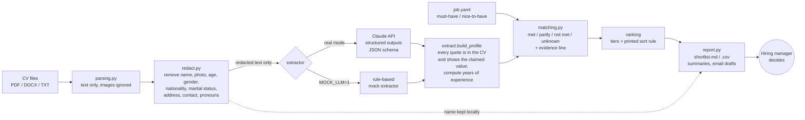

# CV Screening Assistant (human in the loop)

A command-line tool that helps a small company's hiring manager get through incoming CVs
faster. It reads PDF/DOCX CVs, removes protected attributes, extracts skills, experience,
languages and education with a quote from the CV for each claim, checks them against the
job's criteria, and writes a ranked shortlist with reasons, a one-page summary per candidate
and draft reply emails.

**The tool recommends, the human decides.** Nobody is rejected automatically, no email is
sent, and every status comes with the CV line that supports it.

Demo scenario: a 20-person online shop hiring a *Junior Customer Support Specialist*. The 20
CVs in [`samples/`](samples/) are synthetic and fictional (placeholder names, `example.com`
addresses, a "SYNTHETIC CV" footer on every page).

## Quickstart

```bash
python -m venv .venv && source .venv/bin/activate
pip install -e ".[dev]"

# Offline demo, no API key needed (rule-based mock extractor)
MOCK_LLM=1 screen run samples/ --job job.yaml

# Real mode with Claude
cp .env.example .env          # then put your ANTHROPIC_API_KEY in .env
screen run samples/ --job job.yaml
```

Output goes to `out/` (git-ignored, because it contains personal data):

| File | What it is |
|---|---|
| `out/shortlist.md` | Ranked shortlist in three tiers, criteria table, ranking rule, next steps |
| `out/shortlist.csv` | Same, one row per candidate, with status and evidence per criterion. Cells starting with `=`, `+`, `-`, `@`, tab or CR get a leading `'`, so CV text such as `=HYPERLINK(...)` opens as text, not as a formula |
| `out/candidates/<id>.md` | `<id>` is the file name plus 8 characters of the file's SHA-256 (e.g. `cv01-94ae5c33`), so `cv01.pdf` and `cv01.docx` never overwrite each other. One-page summary: criteria with evidence quotes, extracted profile, questions to ask, warnings |
| `out/emails/<id>.md` | Draft reply with three variants (invite / ask for missing info / decline), never sent |
| `out/run_report.json` | Timing, tokens and cost of the run |

The Markdown files are meant to be viewed rendered (VS Code preview, GitHub, any Markdown
viewer). Text that comes from a CV or from the model is escaped (`< > [ ] ( ) ! * _ \ | ``),
so it can never become a link, image, HTML or formatting; in a plain-text editor you will see
backslashes before those characters. A name is shown only if it looks like a name (letters of
any script, spaces, `'`, `.`, `-`); anything else shows as "(not found)" and the email draft
says "Dear applicant,".

If `screen` clashes with GNU screen on your machine, use `python -m cv_screen run ...`.

## Architecture



Design in one paragraph: the model reads, the code decides. The LLM only turns messy CV text
into a strict schema (each item with a verbatim quote). Everything that affects the ranking
(date arithmetic, criterion rules, tiers, sort order) is plain Python driven by `job.yaml`,
so it is testable offline and identical between runs. See [`DECISIONS.md`](DECISIONS.md) for
the reasoning behind each choice.

| Module | Responsibility |
|---|---|
| `cv_screen/parsing.py` | PDF (pypdf), DOCX (python-docx, incl. tables), TXT/MD to normalised text |
| `cv_screen/redact.py` | Remove protected attributes; return the name separately for manager-facing output |
| `cv_screen/schema.py` | Pydantic models; strict JSON schema for structured outputs |
| `cv_screen/extract.py` | `ClaudeExtractor`, `MockExtractor`, quote verification, experience calculation, token cost |
| `cv_screen/matching.py` | Criterion rules, tiers, sort key |
| `cv_screen/pipeline.py` | Runs every CV (in parallel threads), failures go to manual review |
| `cv_screen/report.py` | Markdown, CSV, summaries, email drafts, run report |
| `cv_screen/cache.py` | Extraction cache: validated results by file SHA-256, owner-only, TTL |
| `cv_screen/fileio.py` | Owner-only output files (folders 0700, files 0600, no symlink following) |
| `cv_screen/cli.py` | `screen run` |

## Configuration

### Command line

```
screen run FOLDER --job job.yaml [options]

  --out PATH          output folder (default: out)
  --mock / --real     offline mock extractor or Claude API (default: real unless MOCK_LLM=1)
  --model TEXT        Claude model (default: $CV_SCREEN_MODEL or claude-haiku-4-5-20251001)
  --as-of YYYY-MM-DD  count experience up to this date (default: today)
  --blind             hide names in shortlist and summaries as well
  --workers N         parallel API calls (default: 4)
  --max-file-mb MB    larger files go to manual review unread (default: 5)
  --max-pages N       PDFs with more pages go to manual review (default: 10)
  --max-chars N       CVs with more text go to manual review, not to the model (default: 30000)
  --cache / --no-cache   reuse extraction results of unchanged CVs (default: on in real mode)
  --cache-dir PATH       default: OUT/.cache/extractions
  --cache-ttl-days N     cache entries older than this are deleted (default: 30)
```

Input limits protect against oversized or hostile uploads (cost, memory, zip bombs). A CV over
a limit is never rejected: it is listed under "Needs manual review" with the reason. DOCX files
that unpack to more than 50 MB are treated the same way.

The run summary in the terminal lists the CVs that need manual review and the ones with a file
warning (e.g. hidden PDF text). File names, errors and PDF library warnings can contain
anything an applicant put in the file name or PDF, so control and format characters (terminal
escape sequences, bidi overrides, line separators) are printed as `?`.

### Environment (`.env`, see [`.env.example`](.env.example))

| Variable | Meaning |
|---|---|
| `ANTHROPIC_API_KEY` | Required for real mode. Never commit it; `.env` is git-ignored. |
| `CV_SCREEN_MODEL` | Override the extraction model. |
| `MOCK_LLM` | `1` to run offline with the mock extractor (used by the tests and CI). |

`screen` reads `.env` from the current folder and loads **only these three variables**; any
other line (for example `ANTHROPIC_BASE_URL` or a proxy setting, which could send your key and
CV text elsewhere) is ignored. Variables already set in your shell win. Settings like a proxy
belong in your shell environment, where you set them on purpose.

### Job criteria (`job.yaml`)

```yaml
criteria:
  must_have:
    - id: german
      label: German at B2 or above
      type: language          # CEFR level, "native" counts above C2
      language: German
      min_level: B2
    - id: experience
      label: At least 1 year of customer-facing experience
      type: experience_years  # summed from dated roles the extractor marks as relevant
      min_years: 1
      partly_min_years: 0.5
  nice_to_have:
    - id: helpdesk_tool
      label: Experience with a helpdesk tool
      type: skill             # whole-term match on extracted skills
      any_of: [zendesk, freshdesk, gorgias, help scout, intercom]
      partly_any_of: [crm, hubspot, salesforce]
```

Criterion types: `language`, `language_any`, `experience_years`, `skill`, `education`
(`secondary < vocational < bachelor < master < doctorate`). `relevant_experience.description`
is given to the model to decide which roles count; `relevant_experience.keywords` is used by
the mock extractor and by the evidence check: a role only counts as relevant if its quote
contains one of these keywords.

### Ranking rule (no hidden score)

- **Tier A:** all must-haves met.
- **Tier B:** no must-have clearly missing, but some are `partly` or `unknown`. Check these.
- **Tier C:** at least one must-have looks `not met`. A review flag, not a rejection.

Within a tier: more must-haves met, then more must-haves partly met, then more nice-to-haves
met, then more nice-to-haves partly met, then fewer unknowns, then candidate ID. The rule is
printed at the top of every shortlist.

## Fairness and privacy

**Protected attributes are removed before matching, and a test proves it.**

- Before extraction, `redact.py` removes: name (header line, `Name:` field and every later
  mention), photo markers, date of birth and age phrases, gender, nationality and place of
  birth, marital status and children, religion, address, email, phone, URLs, titles
  (Mr/Ms/Herr/Frau) and gendered pronouns (rewritten to they/them/their). Images are never
  read at all: only the text layer is parsed.
- Only the redacted text is sent to the API. The name stays on your machine and reappears only
  in the manager-facing outputs, in a column labelled "not used for matching" (`--blind`
  hides it there too).
- `tests/test_invariance.py` changes name, address, email, phone, date of birth, nationality,
  gender, marital status, photo and pronouns, and asserts that (a) the text given to the
  extractor is byte-identical, (b) the prompt sent to Claude is byte-identical, and (c) the
  match results are identical. It runs on hand-written variants, on four sample CVs (PDF and
  DOCX), and on DOCX files with and without an embedded photo.
- Missing information is `unknown`, never `not met`, and becomes a question for the
  candidate. Language levels like "fluent" are not guessed into CEFR levels.
- Every claim needs a quote of at least two words (or eight characters) that is found in the CV
  **and contains the claimed value**: the skill name, the language and its level, the job title
  and its start and end years (or "present"/"now"/"since"), the qualification type, field and
  "in progress"/"expected" if unfinished. Claims that fail are dropped and listed as warnings
  in the summary. A role whose quote has none of the job's `relevant_experience.keywords`
  stays in the profile but does not count as relevant, and a month the quote does not show is
  counted as the year only. This is strict on purpose: a true claim the model quoted badly is
  also dropped, but it is listed, so the manager can check the CV instead of trusting a guess.
- **The tool recommends, the human decides.** Every output says so. There is no auto-reject
  and no email sending; the email drafts contain an invite, a "please tell us more" and a
  decline variant, and the manager chooses.

**Data handling and retention**

- Everything runs locally except the extraction call in real mode, which sends redacted CV
  text (redaction is best-effort, see Limitations) to the Anthropic API under your own API key and your organisation's data retention
  settings with Anthropic. Mock mode sends nothing anywhere.
- Output in `out/` contains names and CV content. It is created owner-only (folders 0700,
  files 0600, whatever the umask; existing files are tightened) and written without following
  symlinks, so other users on a shared machine cannot read it. It is git-ignored. Delete it when the
  opening is closed, within the retention period your local rules set (under GDPR, only as
  long as needed for the hiring decision and possible legal claims, unless the candidate agrees
  to longer storage; this is not legal advice). The tool keeps no database.
- **Extraction cache (real mode).** To avoid paying again for CVs it has already read (the n8n
  flow re-screens the whole folder on every new file), the tool stores each validated
  extraction result in `out/.cache/extractions/`: the skills, roles, languages and education
  found in the CV, each with a quote from the *redacted* text. Names and contact details are
  redacted before extraction, but a quote can contain anything the redaction missed, so treat
  the cache as personal data. Entries are keyed by the file's SHA-256, the redacted text and
  the model/prompt/job, so a changed CV, model or job is extracted again; failed extractions
  are never cached; files are owner-only (0600 in a 0700 folder); invalid entries are ignored.
  Entries older than `--cache-ttl-days` (default 30) are deleted at the start of each run.
  Deleting `out/` deletes the cache; `--no-cache` turns it off. Mock mode does not cache
  unless you pass `--cache`.
- No real CVs are in this repository. `scripts/generate_samples.py` regenerates the
  fictional samples byte-for-byte.

## Limitations

- **Redaction is best-effort, not a guarantee.** It is a set of regular expressions. It removes
  labelled fields (`Name:`, `Date of birth:`, `Nationality:`, `Address:` and similar), email
  addresses, phone numbers, URLs, gendered pronouns and titles. It finds the **name only from
  a `Name:` label or from the first line of the CV** (after a "CV"/"Résumé" heading) when that
  line looks like a name. A name placed elsewhere (below a headline, in a sidebar, in the file
  name), an unlabelled address or birth date in free text, or an unusual layout is not removed,
  and in real mode it is sent to the model with the rest of the text. It also cannot remove
  proxies: graduation and employment years hint at age, school or club names at origin or
  gender, a native language at nationality. Check "Removed before matching" in each summary,
  and assume some personal data can reach the API.
- **Hidden text is flagged, not removed.** Text a reader cannot see (white on a page without a
  coloured background, invisible render mode, under 1 pt, or outside the page) is still
  extracted, because the same signals also match the text layer of a scanned CV. When a PDF
  has 30 or more hidden characters, the shortlist row, the summary and the CSV
  (`file_warnings`) say so, and the manager should compare the PDF with the claims. A hidden
  keyword can still back a claim; the warning is what makes that visible. The check is a
  heuristic: white text on a dark image or band counts as visible, and other tricks (text
  under an image, same colour as a coloured background) are not detected.
- **Prompt injection.** The CV is treated as data in the prompt (with `<`, `>` and `&`
  escaped, so it cannot open or close a prompt tag), and the model never decides the ranking,
  but a CV can still try to influence what the model extracts. Evidence checking limits this
  to claims whose value is written in the CV itself: a model told to "add Zendesk" or "start
  the job in 2010" has no quote that shows it, and the claim is dropped.
- **No OCR.** Scanned image-only PDFs go to "manual review".
- **Mock mode only understands the sample layout.** It exists for offline tests and demos; its
  results say nothing about LLM accuracy.
- **Skill matching is literal.** `any_of` terms are matched as whole words against extracted
  skills; synonyms must be listed in `job.yaml`.
- **Year-only dates** count from the middle of the year; "present" counts up to the start of
  the `--as-of` month.
- **Real-mode accuracy has not been measured yet** (see [`CASE_STUDY.md`](CASE_STUDY.md)).
- English-language CVs and criteria only.

## Development

```bash
pip install -e ".[dev]"
ruff check .
pytest -q                               # offline, no API key needed
python scripts/generate_samples.py      # regenerate samples (deterministic)
```

CI (`.github/workflows/ci.yml`) runs lint, the test suite, a reproducibility check of the
samples and a mock-mode run on Python 3.11 to 3.13.

Security tests (each reproduces a finding of the 2026-10-11 security review, see
[`BUILD_LOG.md`](BUILD_LOG.md)): `test_evidence.py`, `test_report_safety.py`,
`test_candidate_ids.py`, `test_limits.py`, `test_hidden_text.py`, `test_cache.py`,
`test_env.py`, `test_terminal.py`, `test_packaging.py`.

Optional automation: [`n8n/`](n8n/) has a workflow that runs the screening when a new CV lands
in a folder and notifies the manager.

Project tracking: [`PROGRESS.md`](PROGRESS.md), [`DECISIONS.md`](DECISIONS.md),
[`BUILD_LOG.md`](BUILD_LOG.md), case study in [`CASE_STUDY.md`](CASE_STUDY.md).
